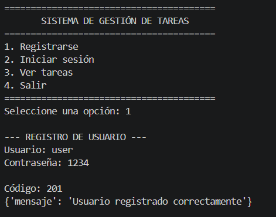
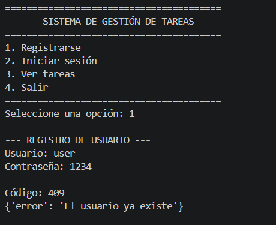
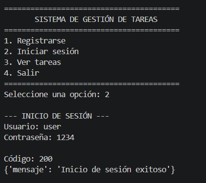
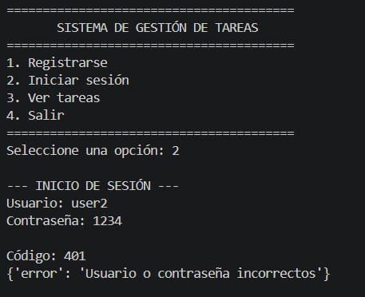
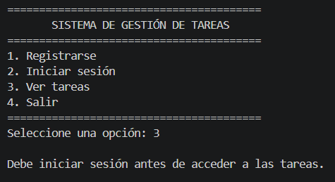
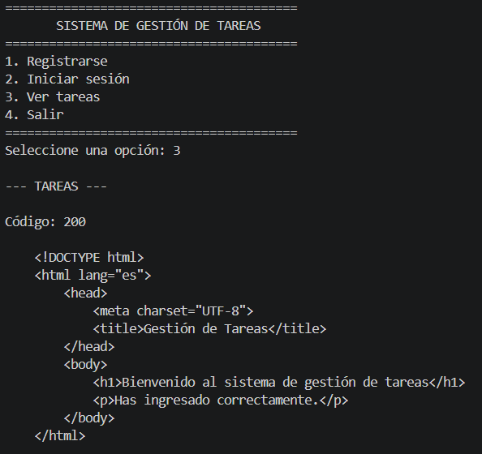
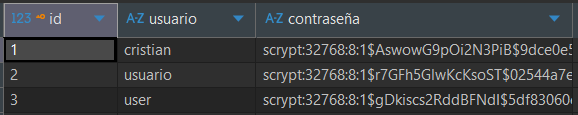

# PFO 2 - Sistema de Gestión de Tareas con API y Base de Datos

**Materia:** Programación sobre Redes\
**Autor:** Edison Cristian Vivar

## 1. Descripción del proyecto

Este trabajo práctico consiste en desarrollar una API REST con Flask,
una base de datos SQLite y un cliente de consola en Python.

El sistema permite registrar usuarios, iniciar sesión mediante la
verificación de sus credenciales y consultar una página HTML de
bienvenida. Las contraseñas se almacenan como hashes y no en texto
plano.

## 2. Tecnologías utilizadas

-   **Python:** lenguaje de programación.
-   **Flask:** desarrollo de la API REST.
-   **SQLite:** almacenamiento persistente de los usuarios.
-   **Werkzeug:** generación y verificación del hash de las contraseñas.
-   **Requests:** envío de peticiones HTTP desde el cliente.

## 3. Archivos del proyecto

-   `server.py`: servidor Flask, endpoints y conexión con la base de
    datos.
-   `client.py`: cliente de consola para interactuar con la API.
-   `requirements.txt`: dependencias necesarias para ejecutar el
    proyecto.
-   `tareas.db`: base de datos SQLite que se crea al iniciar el servidor
    si todavía no existe.

## 4. Requisitos previos

-   Tener Python instalado.
-   Contar con una terminal para ejecutar los comandos.
-   Instalar las dependencias del proyecto.

## 5. Instalación y ejecución

### 5.1. Instalar las dependencias

Abrir una terminal en la carpeta del proyecto y ejecutar:

``` bash
pip install -r requirements.txt
```

### 5.2. Iniciar el servidor

En una primera terminal, ejecutar:

``` bash
python server.py
```

El servidor se ejecuta localmente en:

`http://127.0.0.1:5000`

Mantener esta terminal abierta mientras se utiliza el cliente.

### 5.3. Iniciar el cliente

Abrir una segunda terminal en la misma carpeta y ejecutar:

``` bash
python client.py
```

El menú permite elegir entre registrarse, iniciar sesión, consultar la
página de bienvenida o salir del programa.

## 6. Endpoints de la API

## 6. Endpoints de la API

| Método HTTP | Endpoint | Descripción |
|---|---|---|
| `POST` | `/registro` | Recibe el nombre de usuario y la contraseña, genera el hash y guarda el usuario en SQLite. |
| `POST` | `/login` | Verifica las credenciales con los datos almacenados. |
| `GET` | `/tareas` | Devuelve una página HTML de bienvenida. |

### 6.1. Registro de usuario

El endpoint `POST /registro` recibe un JSON con esta estructura de
ejemplo:

``` json
{
  "usuario": "cristian",
  "contraseña": "1234"
}
```

Si los datos son válidos y el nombre de usuario no existe, el servidor
registra al usuario y devuelve una respuesta de éxito. Si el usuario ya
está registrado, devuelve un mensaje de error.

### 6.2. Inicio de sesión

El endpoint `POST /login` recibe el usuario y la contraseña. El servidor
busca al usuario en SQLite y utiliza Werkzeug para comprobar la
contraseña ingresada contra el hash almacenado.

El cliente considera exitoso el inicio de sesión cuando recibe el código
HTTP `200`. La opción para consultar las tareas queda habilitada en el
menú después de un inicio de sesión exitoso.

### 6.3. Página HTML de bienvenida

El endpoint `GET /tareas` devuelve una página HTML con el título
**Gestión de Tareas** y un mensaje de bienvenida.

En este trabajo, el endpoint devuelve una página de bienvenida; no
implementa operaciones para crear, editar o eliminar tareas.

## 7. Capturas de pantalla de las pruebas

### Registro exitoso



### Registro usuario duplicado



### Inicio de sesión exitoso



### Inicio de sesión incorrecto



### Acceso a la página de bienvenida bloqueado si no esta logueado



### Acceso a la página de bienvenida con usuario logueado



### Verificación del hash de la contraseña



## 8. Respuestas conceptuales

### 8.1. ¿Por qué hashear contraseñas?

Hashear contraseñas permite almacenar una representación de la
contraseña en lugar de guardar el texto original. Así, si alguien
obtiene acceso a la base de datos, no encuentra directamente las
contraseñas de los usuarios. En este proyecto se utiliza Werkzeug para
generar el hash durante el registro y verificar la contraseña ingresada
durante el inicio de sesión. El hash no se descifra para comparar: se
utiliza la función de verificación de la biblioteca.

### 8.2. ¿Qué ventajas tiene usar SQLite en este proyecto?

SQLite es una base de datos liviana que no necesita un servidor
independiente ni una configuración compleja. Guarda la información en un
archivo local, permite conservar los datos entre ejecuciones y se
integra directamente con Python mediante el módulo `sqlite3`. Por estas
características, es una opción práctica para un proyecto académico
pequeño como este.

## 9. Autor

**Edison Cristian Vivar**\
Trabajo Práctico PFO 2 - Programación sobre Redes
